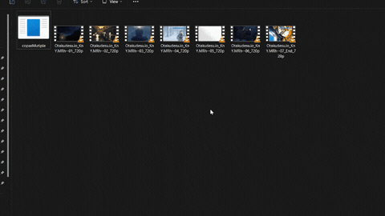

# Copas Multiple

**Copas Multiple** is a batch file renaming utility designed to streamline renaming files in a folder sequentially, particularly useful for removing trademarks or other unwanted text. This app offers portability, enabling easy renaming in any chosen folder.

---

## 🌟 Features

- **Batch Renaming:** Automatically renames all files in a folder in ascending (ASC) order.
- **Portable:** Place the app in any folder and execute for easy file renaming.
- **Trademark Removal:** An efficient solution for modifying file names that contain trademarks or specific phrases.

---

## 📋 Prerequisites

To use Copas Multiple, ensure you have the following installed:

- **Git:** To clone the repository.
- **MinGW** or **Cygwin:** Required to build the app on Windows.
- **Make:** Optionally installed via Chocolatey (for Windows).

### Optional (for Windows):

If you prefer using **Chocolatey** to install `make`, run:
```bash
choco install make
```

## ⚙️ Setup Environment

1. Clone the Repository: Clone the project to your local machine by running:
```bash
git clone <repository_url>
```
2. Navigate to the Project Directory:
```bash
cd copas-mutiple
```

## 🔨 Build the App
Inside the project directory, build the app using:
```bash
make
```

## 🚀 Running the App
Once built, you can run Copas Multiple in two ways:

1. Graphical Interface Execution:
- Double-click the executable file to launch.

Command Line Execution:
- In the terminal, type:
  ```bash
  ./copasm
  ```

This will launch the app in the current directory, allowing you to rename all files sequentially.

Note: You can move the executable to any desired folder to organize files locally in that folder.

## 📝 Example Usage

1. Prepare the Folder: Place Copas Multiple in the folder where you want to rename files.

2. Execute the App: Launch the app to rename all files sequentially (e.g., file1, file2, etc.), with options to add custom titles or episode markers.

## 📂 Folder Structure
```css
copasMutiple/
├── dist/
├── output/
├── src/
│    ├── headers/
│    │    └── fileUtils.h
│    └── utils/
│         └── fileUtils.c
├── test/
│    ├── output/
│    │    └── .gitignore
│    ├── copasMutipleTest.exe
│    ├── example-1.txt
│    ├── example-2.txt
│    ├── example-3.txt
│    └── example-4.json
├── .gitignore
├── main.c
├── Makefile
└── README.md
```

- **src/**: Contains source code files and utilities.
- **dist/**: Compiled object files.
- **output/**: Where renamed files will be saved.
- **test/**: to try.

## 🧹 Clean Build Files
To remove all compiled files and executables, use:
```bash
make clean
```

## Example  🎞️


## Adding CLI 💻
To run Copas Multiple from the command line, follow these steps:

- Move the compiled files on /dist to the global directory:

  for linux/macOs:
  ```bash
  sudo cp dist/copasm /usr/local/bin/copasm
  ```
  for windows:

  Add the environment path in Windows to the executable folder. My suggestion is to create a copasMtiple folder then put all the builds into that folder, and move the folder to C:\\Tools

- running App on terminal

  Now you can run the app anywhere without having to copy the app into the folder containing the files you want to copy and rename, by using the command:
  ```bash
  copasm
  ```

## 📬 Support

If you encounter any issues or have questions, feel free to reach out by creating an issue on the GitHub repository.
